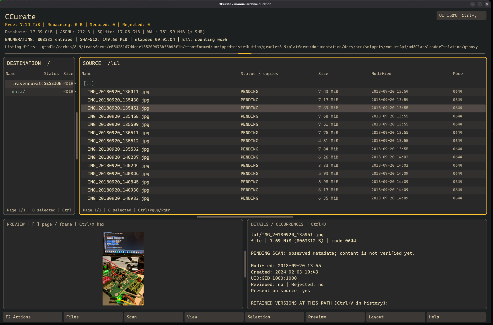

# CCurate

**Curate your files. Keep their history.**

CCurate is a native application for manually turning a crowded old drive
into an organized archive. Decide what matters, choose where it belongs, and keep
a browsable record of where it came from. Identical file contents share one
verified destination copy, even when they originally appeared in many folders.

Written in C11, with a [Raven](https://github.com/oscar-soirey/Raven) interface,
SHA-512 content verification, SQLite sessions and a portable JSON Lines index.
Current version: **0.1.0**. **Linux is the primary platform**; an experimental
native Windows x64 port is available.



## The problem

Years of projects, documents, photos, downloads and copied backups rarely form a
clean archive. Duplicate files consume space, useful files hide among disposable
ones, and moving everything into a new folder structure destroys context:
*Which project used this? Which backup did it come from? What was next to it?*

CCurate treats the original paths as historical information. You build the new
structure yourself, while the application records how the retained files relate
to the old one. Work can span many sessions, with clear distinctions between
files already secured, files reviewed, deliberate rejections and unresolved errors.

## One copy, several historical paths

Suppose these three files contain exactly the same bytes. You choose
`Photos/Family/2016/beach.jpg` as their destination:

| Original path | Physical destination |
| --- | --- |
| `Camera/2016/IMG_0042.jpg` | `Photos/Family/2016/beach.jpg` |
| `Laptop-backup/Pictures/holiday.jpg` | The same file |
| `Old-desktop/To-sort/beach-copy.jpg` | The same file |

Copying one occurrence retains the other known, non-rejected occurrences of that
content too. Each keeps its own original path and recorded metadata. In the
historical browser, all three paths open the same destination content.

Move that destination file later using CCurate and the mappings follow it. The
old names stay intact. Reject one historical occurrence and it is excluded from
the retained tree without deleting the source or the shared destination copy.

**Scanning is inventory, not a decision to keep everything.** The session records
encountered paths so you can make decisions. The portable historical archive
contains retained entries; it does not turn all unreviewed clutter into history.

## Workflow

1. **Open the source and destination.** The old drive appears on the right;
   the destination is on the left. Use existing mounted directories. An
   incremental scan starts automatically and discovers hidden entries as well
   as ordinary files.

2. **Let the inventory and hashing complete.** Files appear while enumeration
   runs. The status bar shows the current phase, errors, hashing progress,
   throughput and an estimated hashing time once the scope is known. Finish
   the traversal before curating so duplicate groups cover the source.

3. **Inspect and decide.** Navigate with the keyboard or click a row. The lower
   panels show a preview, metadata, duplicate occurrences and any verified
   destination location. Mark an item reviewed independently of whether you keep
   it. Reject disposable items explicitly; nothing is deleted from the source.

4. **Build the destination structure.** Create folders on the left with **F7**,
   select source entries on the right and press **F5**. Missing content is copied,
   hashed and independently verified by rereading the destination. An existing
   verified copy is reused. Successful retention records the eligible duplicate
   paths and makes their secured status visible.

5. **Resume and refine.** Close the application and reopen the same source and
   destination to continue. Scanning refreshes changed paths; earlier retained
   versions remain available. Use **F6** to move or rename destination entries
   while keeping historical mappings current. Filter to unsecured items to
   concentrate on what remains.

6. **Audit and account for the remainder.** Audit rereads destination content and
   checks SHA-512. Balance separates secured entries, deliberate rejections,
   unresolved work and errors, and estimates the remaining unique content size.
   Resolve gaps rather than treating a completed scan as a completed archive.

7. **Browse the past from the new drive.** Switch to the historical view, or
   launch with `--browse` after disconnecting the source. Navigate the retained
   old structure while previews read the curated destination files. No FUSE mount
   is needed.

## The workspace

| Area | Purpose |
| --- | --- |
| Top status bar | Free destination space, database and JSONL sizes, scan/job progress and errors |
| Left pane | The curated destination and its current folder structure |
| Right pane | The live source inventory or retained historical tree |
| Lower panels | File preview, metadata, duplicate occurrences and destination locations |
| Optional Activity panel | Filterable diagnostic history, also written to a text log |
| Bottom action menu | Every action, its shortcut and contextual help |

The interface supports both keyboard and mouse. Selection changes on a click or
keyboard navigation, never on hover. Returning to a parent keeps the directory
you left selected, with its list page and scroll position. Double-click a file
to open its default desktop application. Pane separators are draggable, UI scale
ranges from 50% to 400%, and an installed monospace-font chooser avoids typing
font names. Ten color schemes include Tango, Nord, Dracula, Gruvbox Dark,
Catppuccin Mocha and Tokyo Night. Layout and preferences persist per session.

Every content pane has draggable vertical and horizontal scrollbars. File-list
scrollbars span the entire directory, including entries on other pages. Click
any column header to sort, then click again to reverse: name, status/copies,
size, date or permissions. Modified and created dates are both available.
Sorting applies to the whole directory and is saved independently for each pane.

### Main controls

| Key | Action |
| --- | --- |
| `Tab`, arrows, `Enter`, `Backspace` | Switch panes and navigate |
| `Ctrl+Enter` / double-click | Open the file in its default application |
| `Space` / `Insert` | Select multiple entries |
| `F5` | Copy from source to the current destination folder |
| `Ctrl+F5` | Preserve a complete directory in retained history, including empty directories |
| `F6` / `F7` | Move or rename a destination entry / create a destination folder |
| `F8` / `Shift+F8` | Reject / restore a source entry or subtree; **never delete it** |
| `Ctrl+P` | Toggle the independent reviewed marker |
| `Ctrl+F` | Show unsecured, non-rejected entries only |
| `Ctrl+H` | Switch between source and retained history |
| `Ctrl+R` / `Ctrl+Shift+R` | Incremental scan / full rehash |
| `Ctrl+A` / `Ctrl+B` | Audit destination contents / show balance |
| `Ctrl+E` | Audit and look for relocated destination contents |
| `Ctrl+L` | Show or hide Activity |
| `Ctrl+S` / `Ctrl+Shift+S` | Choose a sort column / reverse the current order |
| `Ctrl+T` | Switch the active pane's modified/created date column |
| `Shift+wheel` / `Alt+Left`, `Alt+Right` | Scroll a file table horizontally |
| `F1` / `F2` / `F9` | Help and status legend / all actions / text commands |
| `F10` | Save the session and exit |

The full shortcut reference, preview navigation and layout controls are in the
[user guide](USER_GUIDE.md#workflow-and-keyboard).

### Previews

| Content | Preview |
| --- | --- |
| Images | Scaled image with EXIF orientation and basic metadata |
| PDF | Rendered pages and document metadata |
| Video | Frame preview, metadata and seeking in 10-second steps |
| Audio | Stream information and tags |
| ZIP, TAR and other supported archives | Member listing without extraction |
| Text | Beginning of the text, with optional hex view |
| Other files | MIME information, hex and ASCII |

JPEG previews use libjpeg with reduced-resolution scanline decoding, including
EXIF rotation and mirroring. Other available formats depend on GdkPixbuf loaders, Poppler, FFmpeg and
libarchive. Audio and video are not played in real time. ZIP-based office files
show container contents; there is no office-document renderer. Decoding runs in
a separate process with resource limits; failures appear in the preview and log.

## Build and run

Requirements: Linux, a C11 compiler, CMake 3.20 or newer, pkg-config, OpenSSL,
SQLite3 with JSON support, libarchive and libmagic. The graphical build also
uses X11, Vulkan, Fontconfig, GIO 2.50+ and a working Vulkan driver. Media previews use
libjpeg (libjpeg-turbo is supported), GdkPixbuf, Poppler GLib and FFmpeg's avformat, avcodec, avutil and swscale libraries.
Development headers are required. Python 3 runs the integration tests.

Raven is bundled under `vendor/Raven`; the build does not download it. X11 and
Wayland are supported. GNOME and KDE are not required. ZFS is accessed through
ordinary mounted paths, without pool-management commands or a ZFS-specific API.

```sh
cmake -S . -B build -DCMAKE_BUILD_TYPE=Release
cmake --build build -j
ctest --test-dir build --output-on-failure
./build/ccurate
```

Starting without arguments opens a folder chooser. Use **Browse source** and
**Browse destination** to select directories with the mouse or keyboard; no path
typing is required. Hidden directories are shown. Start curation opens or resumes
the session; Cancel exits without creating one. You can still launch directly
with `./build/ccurate /mnt/source /mnt/destination`, or supply only the source and
choose the destination interactively.

Both directories must already exist. CCurate creates its session files on the
destination; it does not partition or format drives. Root execution is supported
when access requires it, subject to your desktop's display authorization. Preview
workers drop root privileges before decoding. External applications launch as
your desktop user, including when CCurate itself runs through `sudo`.

For dependency package examples, display backend selection and the CLI-only
build, see the [build instructions](USER_GUIDE.md#build).

For Windows, extract the complete **CCurate-windows-x64** Actions artifact and
launch `ccurate.exe`. MSYS2 is needed only to build, not to run the package.
The [Windows guide](docs/WINDOWS_PORT.md) covers installation, native build steps,
separate platform files and limitations, including alternate streams, metadata
and preview restrictions. Windows work is gated by the independent Linux suite.

## Sessions and the portable index

| File on the destination | Contains |
| --- | --- |
| `.ccurate/catalog.sqlite` | Working inventory, versions, decisions, content mappings, recovery state and UI preferences |
| `.ccurate/archive.jsonl` | Retained historical paths, metadata, content hashes, destination mappings and placement history |
| `.ccurate/activity.log` | Timestamped actions, warnings and errors |

Keep the complete `.ccurate` directory with the destination files. Reopen the
same source and destination to resume your CCurate session.

SQLite provides transactional session state. JSON Lines provides a readable,
streamable export: one JSON object per line, suitable for large catalogs and
independent tools. Completed operations or batches publish the export atomically.
Exact filename bytes are preserved alongside readable paths, including names
that are not valid UTF-8.

To browse without the source drive:

```sh
./build/ccurate --browse /mnt/destination
```

Omit the destination argument to choose the archive folder by browsing.

The copied content and JSONL index are sufficient to rebuild the retained
historical browser into an empty catalog. JSONL does not restore unhandled
inventory, working review flags or UI settings. Keep the complete session
directory to continue curation. See [archive format](FORMAT.md) and
[recovery instructions](USER_GUIDE.md#portable-index-and-browsing-without-the-old-drive).

## Data handling and current limits

- **Source operations are read-only.** CCurate has no action to delete, move or
  overwrite source content. Rejection is a catalog decision. Files are not
  executed for previews. Reads on a writable filesystem may still update access
  times according to its mount policy; the live system can also change files.
- **External applications have their own write access.** Double-click, Ctrl+Enter,
  or Files > Open in default application opens the actual source/destination file.
  In history view it opens the retained destination copy. An external editor can
  modify that file; CCurate does not make it read-only for other applications.
- **One physical copy per content hash.** Complete-directory mode preserves the
  historical structure and respects rejections. If content already lives
  elsewhere on the destination, it is reused without creating another file or
  hardlink. A curated project directory may therefore not run independently.
- **Inventory includes special entries.** There is no hidden/system-name filter.
  Symlinks are not followed; symlinks and special objects retain metadata rather
  than being recreated as destination objects. Virtual kernel filesystems are
  visible but their apparent files are not treated as ordinary archive content.
- **Historical metadata differs from destination metadata.** Available original
  ownership, permissions, timestamps and regular-file/directory xattrs, including
  exposed ACLs, are recorded. The destination receives ordinary permissions and
  timestamps, not an exact recreation of ownership, ACLs or privileged mode bits.
- **The source can change.** Startup rescans and freshness checks catch changes;
  a full scan forces rehashing. There is no continuous filesystem watcher or
  atomic whole-filesystem snapshot. Verified status refers to the last check.
- **Large catalogs still need space and validation.** Scans and view queries run
  in workers; the scan plan lives on disk and lists are paged. Remaining bytes
  are logical content sizes, not a guarantee of physical space after compression,
  sparse-file allocation and metadata. A full 8 TB archive has not been validated
  in the development environment. Measured checks and remaining limits are
  recorded in [TESTING.md](TESTING.md).

## Documentation

- [User guide](USER_GUIDE.md): controls, scan phases, fonts, logs, complete
  directories, live-source behavior, previews and recovery.
- [Archive format](FORMAT.md): JSONL records, path encoding and session semantics.
- [Validation](TESTING.md): executed tests, environments and untested scenarios.
- [Changelog](CHANGELOG.md): changes across releases.
- [Source architecture](ARCHITECTURE.md): C modules, header interfaces and UI
  state/thread ownership.
- [Third-party notices](THIRD_PARTY.md): bundled Raven revision and dependencies.
- [Windows guide](docs/WINDOWS_PORT.md): native package, build automation,
  platform separation and documented differences.
